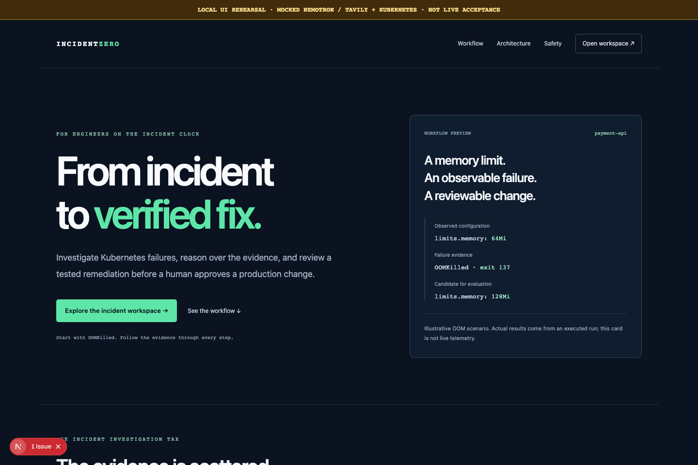
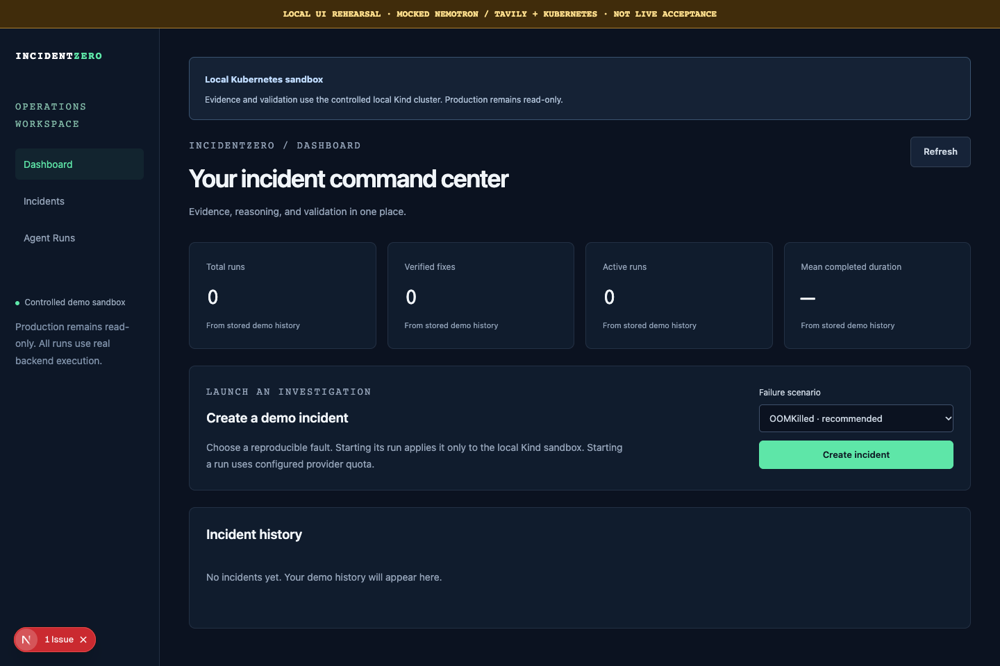
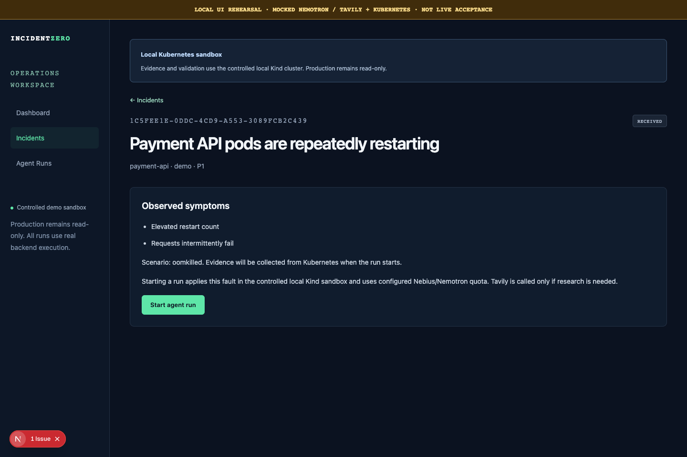
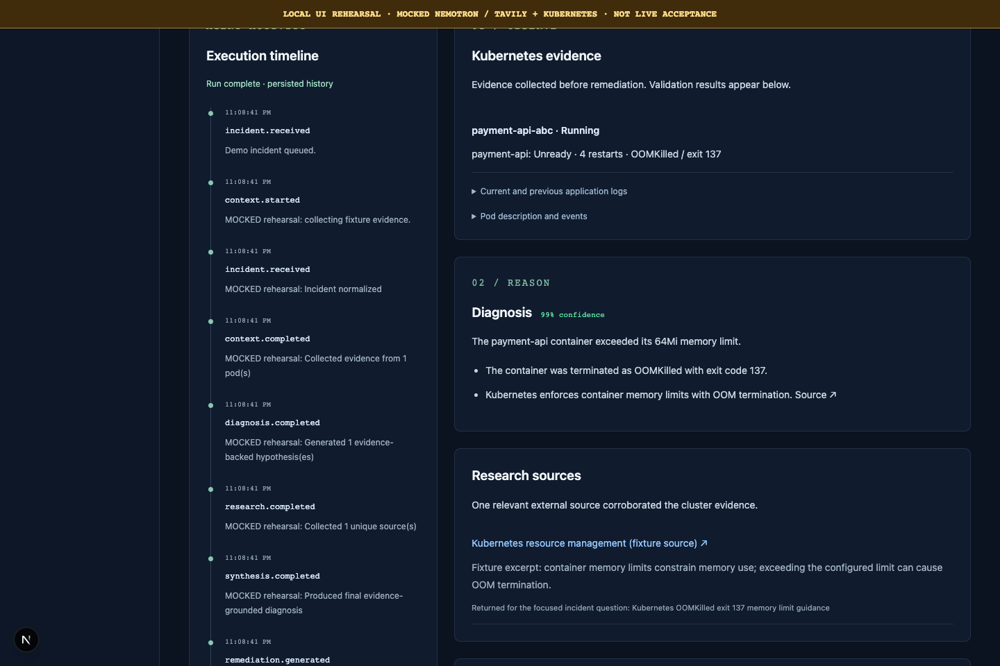
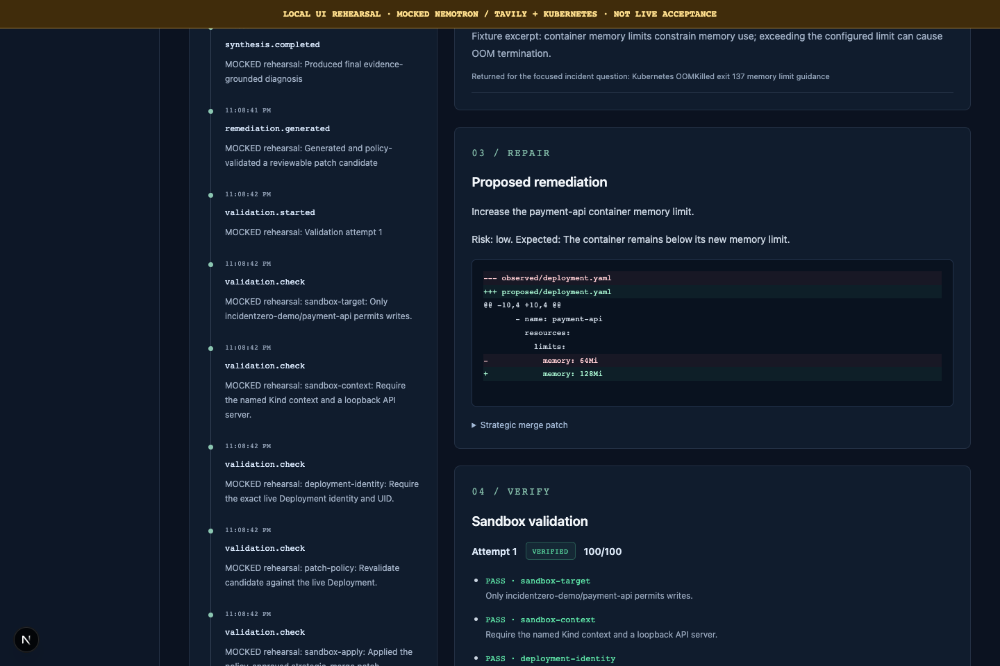

# IncidentZero

**From production incident to verified fix — autonomously.**

An evidence-driven Kubernetes incident engineer built for the Nebius x NVIDIA Global AI Hackathon 2026. IncidentZero collects observations, uses NVIDIA Nemotron through Nebius Token Factory to reason, researches conditionally with Tavily, generates a constrained YAML patch, and validates it in a controlled sandbox for human review.

[MIT license](LICENSE) · [Architecture](docs/architecture.md) · [Safety](docs/safety.md) · [Demo runbook](docs/demo.md) · [Development](docs/development.md) · [Deployment](docs/deployment.md)

| Project link | Current state |
| --- | --- |
| Source | [GitHub repository](https://github.com/rakshitsharma0402/incidentzero); public visibility must be confirmed for submission |
| Live demo | **Pending deployment** — no verified public URL |
| Final live video | [Public YouTube demo](https://youtu.be/RaPNBI7qMDQ) — verified online at 2:31 |
| Local rehearsal video | [Captioned rehearsal WebM](docs/assets/rehearsal.webm) — mocked model/search/Kubernetes, not live evidence |
| DEV.to | [Unpublished article draft](docs/submission/article.md) |
| Devpost | [Submission draft](docs/submission/devpost.md) — not submitted |
| Release status | [Explicit unresolved gates](docs/submission/readiness.json) |

## Problem and solution

Kubernetes incident evidence is scattered across pod state, prior terminations, events, logs, and manifests. A patch is not a resolution until there is observable evidence that it addresses the failure.

IncidentZero turns that investigation into a visible run: symptoms → evidence → hypotheses → optional research → final diagnosis → reviewable patch → policy validation → bounded sandbox evaluation → RCA. It is an operator workspace, not a chat interface. Production changes are not implemented or executed.

## Features

- OOMKilled primary demo, plus configuration CrashLoop and readiness failures for `payment-api`.
- Typed structured diagnosis, final synthesis, and remediation generation through Nemotron.
- Conditional Tavily research with bounded focused queries, deduplicated sources, and citation validation.
- Safe YAML parsing and exact-target/configuration allow-lists; no arbitrary generated commands.
- Two remediation attempts, named checks, scores, explicit terminal errors, and retained failure evidence.
- SQLite incidents/runs/history, one active-run claim, restart recovery, and replayable SSE.
- Dashboard, incident/run details, evidence, timeline, diagnosis confidence, source panel, diff, validation, and Markdown RCA download.
- Distinct hosted infrastructure simulation, operator code/pause controls, daily start limits, and metadata-only structured logs.

## Verification status

Live Nebius/Nemotron and Tavily connectivity, five consecutive real API-to-Kind OOM runs, container-runtime checks, and an additional UI-driven verified recording run are complete. Deterministic backend/browser tests still mock external boundaries by design. Public deployment remains pending, and Firefox is locally blocked at profile startup. See [state of play](docs/INCIDENTZERO_STATE_OF_PLAY.md) for exact recorded checks and limitations.

The internal feature-complete deadline is **October 25, 2026**. October 30 is the submission deadline, not the engineering target. October 25 local materials are prepared; the release is not submission-ready while the live/publication gates remain unresolved.

## Architecture and workflow


Next.js connects to FastAPI REST/SSE. A worker owns the LangGraph async loop, while SQLite persists partial/final state and events. Nemotron forms hypotheses, synthesizes evidence, and generates a patch. A deterministic policy sits between model output and environment evaluation.

| Mode | Infrastructure | Reasoning | Result |
| --- | --- | --- | --- |
| Local Kubernetes | Real controlled Kind evidence and checks | Real configured Nemotron; conditional Tavily | `verified` only if every check passes |
| Hosted simulation | Explicitly simulated evidence/configuration checks | Real configured Nemotron; conditional Tavily | `simulated`, never counted as a Kubernetes-verified fix |
| Rehearsal/tests | Fixture data | Mocked outputs | Clearly labeled; not live acceptance |

Maximum two remediation applications. A malformed structured response receives one repair attempt. Human review is required before any production action; no production deployment endpoint exists.

## Screenshots

All eight screenshots below are local UI rehearsals with a visible mock banner. They do not show live provider or Kubernetes execution. [Capture provenance](docs/assets/capture-manifest.json).

| Landing | Dashboard |
| --- | --- |
|  |  |
| Incident overview | Agent timeline |
|  |  |
| Diagnosis | Conditional research |
|  |  |
| Remediation diff | Sandbox checks |
|  |  |

## Stack and integrations

| Layer | Implementation |
| --- | --- |
| Reasoning | NVIDIA Nemotron through Nebius Token Factory's OpenAI-compatible chat-completions API |
| Research | Conditional Tavily Search with compact results |
| Agent | LangGraph, typed state, Pydantic boundaries |
| Backend/history | Python 3.12+, FastAPI, SQLite, SSE |
| Frontend | Next.js, React, TypeScript, Tailwind CSS |
| Local sandbox | Docker, Kind, Kubernetes, kubectl, plain manifests/Kustomize |
| Deployment preparation | Standalone Node frontend, Python service, non-root containers, optional free-tier blueprint |

The model ID is environment-configurable; use one actually available to the account. There is no hard-coded production diagnosis or unconditional search call. No cloud cluster or paid personal spend is required for offline checks.

## Project structure

```text
backend/app/          API, models, graph, agents, clients, persistence, validation
backend/scripts/      Provider checks and guarded five-run acceptance recorder
backend/tests/        Deterministic tests and isolated visual fixtures
frontend/app/         Landing, dashboard, incidents, and run views
frontend/tests/       Domain/browser tests and labeled asset capture
sandbox/              Healthy workload, three faults, cluster/reset scripts
deploy/               Containers and read-only deployed smoke script
docs/                 Architecture, safety, demo, development, deployment, handoff
docs/assets/          Versioned rehearsal visuals and provenance
docs/submission/      Article, Devpost fields, readiness and acceptance templates
scripts/              Offline submission-package integrity check
```

## Setup

Prerequisites: Python 3.12+, Node 22.18+ or 24, npm. Real Kubernetes mode additionally needs Docker, Kind, and kubectl. Offline tests and rehearsal capture need no provider key.

```bash
cp .env.example .env
python3 -m venv backend/.venv
backend/.venv/bin/pip install -r backend/requirements-dev.txt
cd frontend
npm install --no-audit --no-fund
```

The inherited npm 11 optional sharp lock-resolution issue currently blocks `npm ci` locally. The documented `npm install` setup is verified; do not claim clean-install validation passed.

```bash
# Terminal 1, repository root
backend/.venv/bin/uvicorn app.main:app --app-dir backend --host 127.0.0.1 --port 8000

# Terminal 2, frontend/
npm run dev
```

Open `http://localhost:3000`. Health: `http://127.0.0.1:8000/health`. API schema: `http://127.0.0.1:8000/docs`.

Set up the real lab with [sandbox/README.md](sandbox/README.md). Do not start a live run until provider quota is deliberately authorized. For a provider-free visual walkthrough use `npm run capture:submission`, described in [demo.md](docs/demo.md).

## Environment

| Setting | Purpose |
| --- | --- |
| `NEBIUS_API_KEY`, `NEBIUS_BASE_URL`, `NEBIUS_MODEL`, `NEBIUS_TIMEOUT_SECONDS` | Backend-only reasoning credentials, endpoint, model, and bounded request timeout |
| `TAVILY_API_KEY`, `TAVILY_BASE_URL` | Backend-only conditional research |
| `NEXT_PUBLIC_API_URL` | Public backend origin; export before frontend build/dev for nondefault origins |
| `CORS_ORIGINS` | Exact allowed frontend origins; HTTPS required in production |
| `DATABASE_PATH`, `KUBECTL_BIN` | Persistent SQLite file and local kubectl binary |
| `APP_ENV`, `EXECUTION_MODE` | `local`/`production`, `kubernetes`/`simulation`; public mode supports simulation only |
| `RUNS_ENABLED`, `DEMO_RUN_TOKEN`, `DAILY_RUN_LIMIT` | Operator pause, mutation code, per-UTC-day start bound |
| `STORAGE_EPHEMERAL` | Notice that hosted history may reset |
| `API_HOST`, `API_PORT` | Example launch values; uvicorn host/port are supplied as CLI flags |

Never commit credentials. The backend loads root `.env`; the frontend does not automatically load that parent file. Production defaults to paused runs. `.env.example` is for local development, not a production configuration to copy wholesale. See [deployment.md](docs/deployment.md) for validated settings, free-tier limits, and access instructions.

## Testing and freeze checks

```bash
# Repository root
backend/.venv/bin/python -m pytest backend -q
backend/.venv/bin/python -m pip check
backend/.venv/bin/python -m compileall -q backend/app backend/tests backend/scripts scripts deploy
git diff --check

# frontend/; keep browser capture and builds sequential
npm run lint
npm run typecheck
npm test
npm run build
```

For Chromium/WebKit checks and browser installation, see [development.md](docs/development.md). For live integration checks and the five-run recorder, see [demo.md](docs/demo.md); execution consumes quota only with deliberate flags. Its plan mode makes no provider/cluster requests.

```bash
# Local artifact/links/labels integrity, no external calls
python3 scripts/check_submission.py

# Expected to fail while live/deployment/publication gates are pending
python3 scripts/check_submission.py --release-ready
```

## Safety and limitations

Only the fixed Kind demo target permits controlled writes. Generated patches cannot change images, commands, replicas, security fields, secrets, or unrelated resources. Every check must pass; no high partial score overrides failure. Health is point-in-time, not a sustained stability measurement.

The public demo is not production-ready enterprise infrastructure. There is no production approval/apply engine, enterprise authentication/RBAC, multi-cluster management, or customer impact measurement. History on ephemeral hosting can disappear, and daily limits are not provider billing caps. See [safety.md](docs/safety.md).

## Roadmap and submission

Finish live providers/Kind acceptance, five successful golden-path recordings, container validation, and a verified public URL. Replace the rehearsal with final live video, review team details and provider feedback, publish approved article/video, and submit through Devpost. No final feature-complete or publication claim is made before those gates pass.

## Team and contribution

The Git history records contributions under Rakshit Sharma and Aryan Sharma. Confirm the final team roster, attribution, submission representative, and consent with the contributors; roles are not inferred here. See [collaborator guide](docs/CODEX_COLLABORATOR_GUIDE.md) and [state of play](docs/INCIDENTZERO_STATE_OF_PLAY.md) before changing the project.

## License

[MIT](LICENSE), selected by the user. Dependencies, provider services, model weights, and third-party documentation retain their own licenses and terms.
