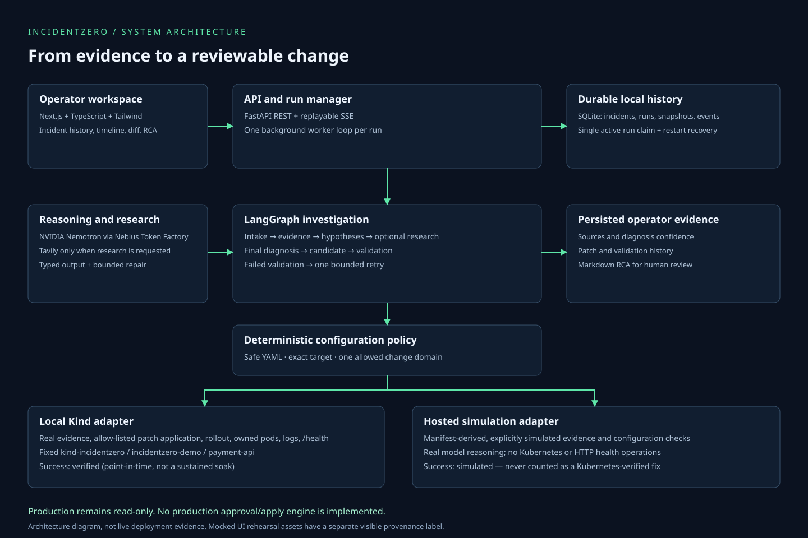
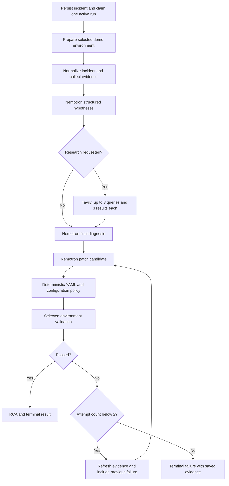

# Architecture

IncidentZero is an incident workflow application. The operator creates a controlled demo, starts a persisted run, inspects evidence and a proposed change, and exports an RCA. It does not deploy a fix to production or implement production approval/execution.

The SVG is the editable source; `assets/architecture.png` is an export for submission materials. The diagram describes the implemented architecture, not a deployed environment.

## Components and boundaries

| Component | Responsibility | Source |
| --- | --- | --- |
| Next.js workspace | Dashboard, incident/run routes, evidence, timeline, sources, diff, validation, RCA | `frontend/app`, `frontend/components` |
| REST + SSE | Typed incident/run responses, background starts, durable event replay | `backend/app/api/incidents.py` |
| SQLite | Incident/run snapshots, terminal status, events, daily start count | `backend/app/storage/sqlite.py` |
| Run manager | Worker thread with its own async loop; incremental persistence; final report | `backend/app/services/runs.py` |
| LangGraph | Intake, collection, diagnosis, optional research, synthesis, remediation, validation/retry | `backend/app/graph/workflow.py` |
| Nemotron on Nebius | Structured hypotheses, final diagnosis, policy-constrained patch candidates | `backend/app/agents`, `backend/app/integrations/nebius.py` |
| Tavily | Focused compact research only when requested by diagnosis | `backend/app/agents/research.py` |
| Patch policy | Safe YAML parsing, exact identity/shape, allow-listed change domain | `backend/app/services/remediation.py` |
| Local Kind adapter | Fixed sandbox preparation, real evidence, patch application, pod/log/health checks | `backend/app/services/demo.py`, `sandbox.py` |
| Hosted simulation adapter | Marked manifest-derived evidence and modeled configuration evaluation | `backend/app/services/simulation.py` |

## Execution flow

Malformed structured model responses have one repair attempt. This is distinct from the maximum of two remediation applications. The planning-only graph can omit a verifier; the product run manager supplies the chosen adapter explicitly. Its report renderer runs after graph completion rather than inside a separate model node.

## Persistence and concurrency

A SQLite partial unique index permits one queued/running execution across all incidents. Creation and daily-limit checking share a write transaction. Each operation opens/closes its own connection. WAL supports short concurrent reads. A file lease rejects a second process using the same database. Use one backend worker/replica; separate database files do not coordinate access to one Kind sandbox.

A worker thread owns the graph's async loop so synchronous bounded kubectl operations do not block the API event loop. Node updates produce snapshots and events; `run.completed` commits with terminal run/incident status. Restart recovery marks interrupted runs failed when the database survives. Storage replacement on an ephemeral host loses that history.

SSE replays monotonic event IDs using `after` or `Last-Event-ID`, emits heartbeats, and closes after terminal events. The UI merges streamed and polled events by ID; periodic reads provide fallback when a stream disconnects. Queue/running results are partial snapshots, not final diagnoses.

## Real, simulated, and mocked

| Execution | Infrastructure | Reasoning | Successful terminal status |
| --- | --- | --- | --- |
| Local product | Real Kind collection and verification | Real configured Nemotron; conditional Tavily | `verified` |
| Hosted product | Explicit configuration simulation, no Kubernetes operations | Real configured Nemotron; conditional Tavily | `simulated` |
| UI rehearsal/test | Explicit fixtures | Mocked model/search output | Fixture status; assets are visibly marked |

Only the first mode can provide real Kubernetes acceptance. A point-in-time `/health` pass is not a stability/soak measurement. Past Linux verification used real Kind with mocked reasoning; it does not establish live provider reasoning or five-run stability.

## Deployment state

The frontend has a standalone Node build and the backend is a Python service. Container and free-tier preparation is described in [deployment.md](deployment.md). There is no verified public deployment URL yet. No cloud service or personal payment is required for offline tests, screenshot capture, or the rehearsal recording.
